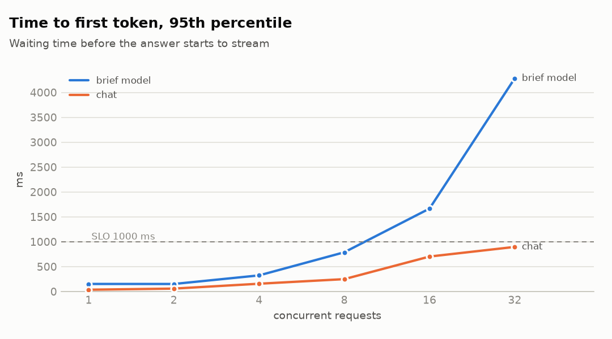
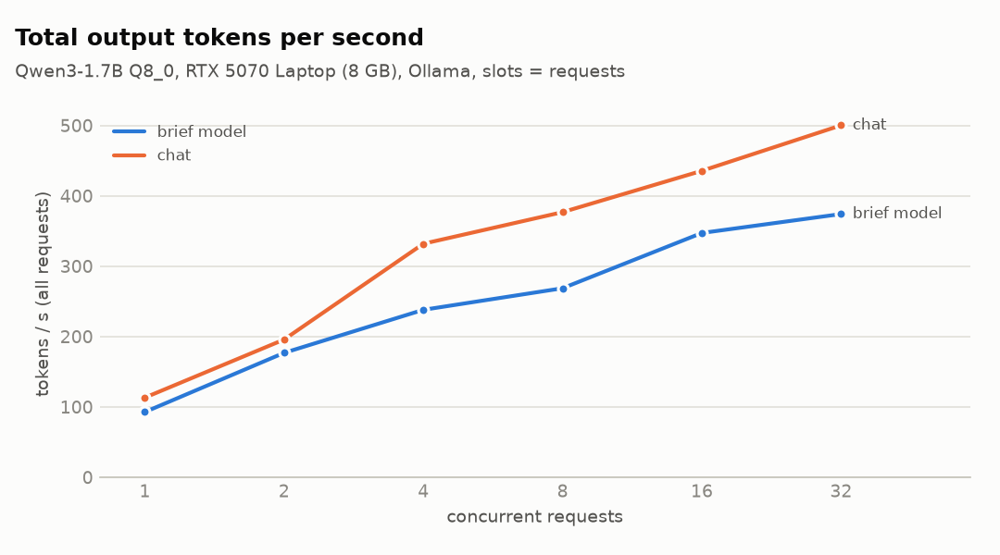
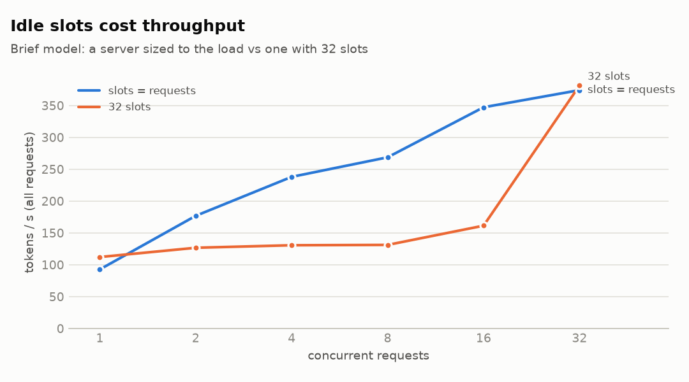
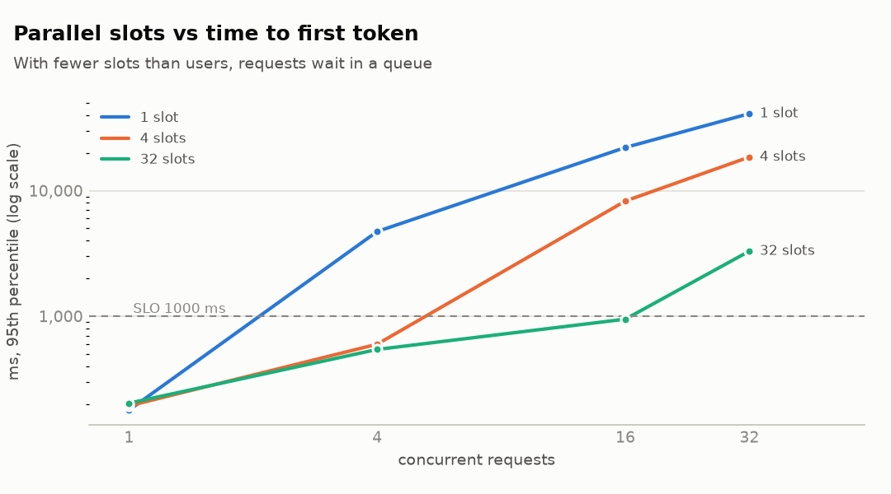
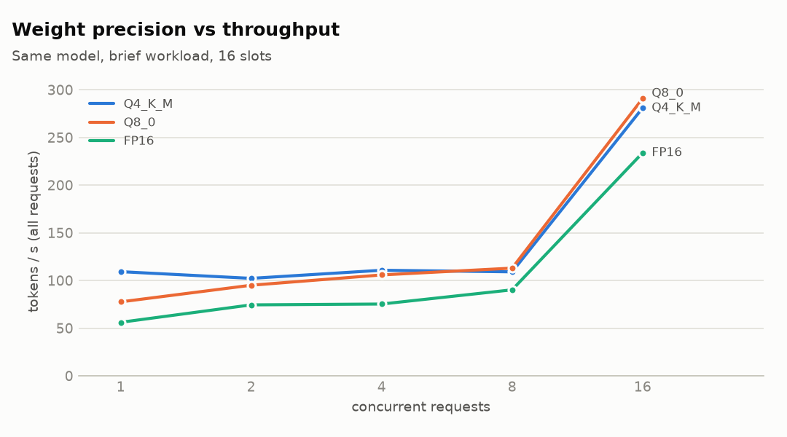

# LLM capacity planner

How many GPUs does it take to serve a small LLM chatbot to N users, and what does it cost a month? This project load-tests Qwen3-1.7B on a laptop GPU, measures latency and throughput at 1 to 32 concurrent requests, and turns the measurements into a GPU count and a monthly bill for cloud GPUs.

**[Open the calculator](https://etipufhu.github.io/llm-capacity-planner/)**: enter the number of users, the latency target and the GPU, and get the GPU count and monthly cost.

## Results

Service level objective (SLO): the answer starts within **1 s** for 95% of requests, then streams at **10 tokens/s or faster** for 95% of requests. Measured on one RTX 5070 Laptop GPU (8 GB) with Ollama, one parallel slot per concurrent request:

| Concurrent requests | Brief: tokens/s (all) | Brief: TTFT p95 | Brief: ITL p95 | Chat: tokens/s (all) | Chat: TTFT p95 | Chat: ITL p95 |
|--:|--:|--:|--:|--:|--:|--:|
| 1 | 93 | 153 ms | 11 ms | 113 | 37 ms | 9 ms |
| 2 | 177 | 152 ms | 10 ms | 196 | 59 ms | 10 ms |
| 4 | 238 | 324 ms | 17 ms | 332 | 157 ms | 12 ms |
| 8 | 269 | 789 ms | 27 ms | 377 | 249 ms | 23 ms |
| 16 | 347 | **1,666 ms** | 45 ms | 436 | 703 ms | 50 ms |
| 32 | 374 | **4,282 ms** | 80 ms | 500 | 897 ms | 92 ms |

No request failed in any run. Raw data: [`results/summary.csv`](results/summary.csv) and every single request in [`results/raw/`](results/raw).

- **The brief model holds about 9 concurrent requests within the SLO on the laptop**, which serves about 56 active users. Its 740-token prompts make the first token the limit: prefill of new prompts competes with decoding of running ones.
- **Short chat prompts still meet the SLO at 32 concurrent requests**, the highest level tested, so one laptop GPU serves at least ~118 active chat users.
- **For 1,000 active users** the cheapest estimate is 10 × A10G (about $7,300 a month) for the brief model and 2 × A100 (about $4,000 a month) for chat. An L4 has less memory bandwidth than this laptop GPU (300 vs 384 GB/s) and comes out no faster.

<picture>
  <source media="(prefers-color-scheme: dark)" srcset="docs/img/ttft-dark.png">
  
</picture>

<picture>
  <source media="(prefers-color-scheme: dark)" srcset="docs/img/throughput-dark.png">
  
</picture>

### GPUs and cost for 1,000 active users

Users read and type for 30 s between messages, 20% of capacity is kept free. Only the laptop row is measured; the cloud rows are estimates scaled by memory bandwidth (see method and limitations below).

#### Weekly brief (PR Radar model, ~740 tokens in, ~145 out)

| GPU | | Max concurrent requests (SLO) | Bound by | Users per GPU | GPUs | $ / month |
|---|---|--:|---|--:|--:|--:|
| RTX 5070 Laptop | measured | 9 | measured | 56 | 18 | n/a |
| L4 | estimate | 7 | first token | 45 | 23 | 13,513 |
| A10G | estimate | 12 | first token | 100 | 10 | 7,344 |
| L40S | estimate | 18 | first token | 155 | 7 | 9,510 |
| A100 40GB | estimate | 31 | first token | 294 | 4 | 8,015 |
| H100 80GB | estimate | 66 | first token | 662 | 2 | 10,045 |

#### Chat assistant (~60 tokens in, ~175 out)

| GPU | | Max concurrent requests (SLO) | Bound by | Users per GPU | GPUs | $ / month |
|---|---|--:|---|--:|--:|--:|
| RTX 5070 Laptop | measured | ≥ 32 | not reached | 118 | 9 | n/a |
| L4 | estimate | 25 | first token | 88 | 12 | 7,050 |
| A10G | estimate | 51 | first token | 192 | 6 | 4,406 |
| L40S | estimate | 75 | first token | 286 | 4 | 5,434 |
| A100 40GB | estimate | 136 | first token | 529 | 2 | 4,007 |
| H100 80GB | estimate | 295 | first token | 1162 | 1 | 5,022 |

### What changes the numbers

**Size the slot count to the load.** In this Ollama build, slots that are allocated but idle slow every decoding step. The same brief workload at 4 concurrent requests gives 238 tokens/s with 4 slots and 131 with 32; at 8 requests, 269 vs 131.

<picture>
  <source media="(prefers-color-scheme: dark)" srcset="docs/img/slots-throughput-dark.png">
  
</picture>

**Too few slots queue the requests.** With 1 slot the stream stays fast (ITL ~10 ms) but the first token waits for every request ahead: p95 TTFT is 4.7 s at 4 concurrent requests and 41 s at 32. With 4 slots, throughput stops at ~200 tokens/s and TTFT grows the same way past 4 requests.

<picture>
  <source media="(prefers-color-scheme: dark)" srcset="docs/img/parallel-ttft-dark.png">
  
</picture>

**8-bit KV cache, not 16-bit.** 32 slots of 1536 tokens need 2.9 GB of KV cache in 8 bit and 5.6 GB in 16 bit. The 16-bit version does not fit next to the model on an 8 GB card, so llama.cpp moved 4 of the 29 layers to the CPU, and throughput fell by 30 to 45% (e.g. 96 vs 176 tokens/s at 16 requests).

**Weight precision matters most for a single user.** One request streams at 109 tokens/s with Q4_K_M, 78 with Q8_0 and 56 with FP16, about in proportion to the bytes read per token. At 16 concurrent requests the prompts dominate and Q4 and Q8 are within 4% (281 vs 291 tokens/s), with FP16 at 234.

<picture>
  <source media="(prefers-color-scheme: dark)" srcset="docs/img/quant-throughput-dark.png">
  
</picture>


## What was measured

Two workloads, both on Qwen3-1.7B at 8-bit (Q8_0), served by Ollama 0.40.17 on one RTX 5070 Laptop GPU (8 GB GDDR7, 384 GB/s):

| Workload | Model | Input | Output | Prompts |
|---|---|--:|--:|---|
| **brief** | the weekly media brief model from [PR Radar](https://github.com/Etipufhu/pr-radar): Qwen3-1.7B with its LoRA adapter (distilled from Qwen3-4B) merged in | ~740 tokens: house rules + a fact sheet | ~145 tokens | the 154 real fact sheets from PR Radar's training set |
| **chat** | stock Qwen3-1.7B | ~60 tokens | ~175 tokens (max 320) | 160 synthetic "explain X in about N words" questions |

The load generator ([`client.py`](src/capplan/client.py)) is a closed loop: `c` workers each send a streaming request to the OpenAI-compatible endpoint, read the stream to the end and send the next one, so the server always has `c` requests in flight. Each concurrency level runs `4 × c` requests (at least 16). Per request it records:

- **TTFT**: time to the first streamed token
- **inter-token latency (ITL)**: (time of last token − time of first token) / (tokens − 1); the reader's streaming speed is 1 / ITL
- **end-to-end time**, prompt and output tokens (from the server's `usage` block) and errors

Per run it adds total output tokens per second, p50/p95/p99 of the above, and the GPU's VRAM, utilisation and power from `nvidia-smi`, sampled every second.

Server setup ([`configs/tuned.yaml`](configs/tuned.yaml)): a fresh `ollama serve` for each concurrency level with that many parallel slots, 1536 tokens of context per slot, flash attention, 8-bit KV cache, thinking disabled (`reasoning_effort: none`). [`configs/headline.yaml`](configs/headline.yaml) runs the same workloads with a fixed 32 slots, [`configs/server.yaml`](configs/server.yaml) and [`configs/quant.yaml`](configs/quant.yaml) the comparisons above. The VRAM column in the results includes about 2.8 GB used by the desktop; the model's own share is `model_vram_mib`. Every prompt in a run is different and llama-server's cross-request prompt cache is switched off (`LLAMA_ARG_CACHE_RAM=0`), so no answer starts from a cached prompt. The shared system prompt can still be reused inside a slot, as it would be in production.

## From measurements to GPUs and dollars

The model is in [`capacity.py`](src/capplan/capacity.py) and the same formulas run in the [calculator](docs/app.js).

1. **SLO.** Default: p95 TTFT ≤ 1 s and at least 10 tokens/s for 95% of requests (p95 ITL ≤ 100 ms), error rate ≤ 1%. The highest concurrency that meets it on the laptop is read off the measured curve, interpolating between the two measured levels around the crossing.
2. **Concurrent requests to users (Little's law).** An active user sends a message, waits W seconds for the answer and spends Z seconds reading and typing. On average they keep W / (W + Z) requests in flight, so one slot that is never idle serves (W + Z) / W users. Default Z = 30 s, and 20% headroom is kept free for bursts.
3. **Other GPUs (estimate).** Generating tokens with a small model is bound by memory bandwidth: every step reads the weights and the KV cache. Latencies are divided by `bandwidth_gpu / 384 GB/s`. The p95 TTFT and ITL curves are fitted as `a + b · concurrency` on the measured points and solved for the SLO. A second limit is how many KV caches fit in the card's memory next to the weights. Whichever limit is lower wins.
4. **Cost.** GPUs = ⌈users / users per GPU⌉, monthly cost = GPUs × hourly price × 730 h. Prices are AWS on-demand (Linux, us-east-1) for the smallest instance with that GPU, divided by its GPU count, read from [instances.vantage.sh](https://instances.vantage.sh) on 2026-11-21 ([`configs/gpus.yaml`](configs/gpus.yaml)).

## Limitations

- **One laptop GPU, one run each.** A laptop 5070 shares power and heat with the CPU, and its clocks move with temperature. The same single-request setup measured 93 and 112 tokens/s in two runs, so differences under about 15% are within noise. Background GPU use matters more: in a trial run with other GPU apps open, throughput at 32 concurrent requests fell to a sixth of the clean run.
- **The cloud rows are not measured.** Bandwidth scaling ignores compute limits (prefill of long prompts is compute-bound), tensor-core generations, PCIe vs SXM and multi-GPU effects. The linear fit is used far outside the measured range (the laptop stops at 32 concurrent requests; the H100 estimate goes much higher).
- **Ollama is not a production server.** llama-server's batching is simpler than vLLM's or TensorRT-LLM's continuous batching with paged attention, so the cloud estimates are what you would get running Ollama on those cards, not the best those cards can do.
- **Closed-loop load.** Real users arrive at random, which makes queues longer at the same average load than a closed loop shows. The 20% headroom is a rough allowance for that, not a queueing model.
- **Prices change**, and reserved, spot or other providers can be much cheaper. The calculator lets you type your own.

## Reproduce

Windows or Linux with an NVIDIA GPU and Python 3.11+.

```powershell
python -m venv .venv
.venv\Scripts\pip install -e ".[dev]"
```

Get Ollama 0.40.17 (the portable zip from the [release page](https://github.com/ollama/ollama/releases/tag/v0.40.17), unpacked into `.tools/ollama/`, or any install on `PATH`). The sweep starts its own `ollama serve` on port 11435 for every server setup and stops it afterwards, so nothing keeps running.

The brief model needs the PR Radar adapter. Merge it into the base model, convert it to an 8-bit GGUF with llama.cpp's converter and import it:

```powershell
python scripts/merge_brief_lora.py ../pr-radar/adapters/brief-lora-qwen3-1.7b models/brief-qwen3-1.7b
python .tools/llama.cpp/convert_hf_to_gguf.py models/brief-qwen3-1.7b --outtype q8_0 --outfile models/brief-qwen3-1.7b-q8_0.gguf
ollama create brief-qwen3:q8_0 -f configs/brief.Modelfile
```

(Ollama 0.40 dropped runtime LoRA adapters and only quantizes safetensors imports through MLX, so the adapter is merged and converted outside Ollama.)

Then run the sweeps, about 45 minutes in total, and rebuild the tables, charts and calculator data:

```powershell
capplan sweep configs/tuned.yaml configs/headline.yaml configs/quant.yaml configs/server.yaml
capplan report
```

`capplan run --base-url http://host:8000/v1 --model NAME -c 16 -n 64` load-tests any other OpenAI-compatible server (vLLM, llama-server, a hosted API) with the same client.

## Layout

```
src/capplan/   client.py (load generator), stats.py, gpu.py (nvidia-smi sampler),
               ollama.py (server per config), sweep.py, capacity.py, report.py, plots.py
configs/       sweep configs, GPU specs and prices, the brief model's Modelfile
data/prompts/  brief.jsonl (from PR Radar)
results/       raw/<run>/c<NNN>.json (every request), summary.csv, capacity.md
docs/          calculator page (GitHub Pages) and the charts
```

## Next steps

- Run the same sweep on vLLM (Linux or WSL2), which can serve the LoRA adapter without merging, and on one real cloud GPU to check the bandwidth estimate against a measurement.
- Open-loop load (Poisson arrivals) to measure queueing instead of allowing for it with headroom.
